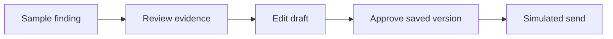

# Selected project notes

These are high-level overviews of ongoing private implementation work. The examples use invented data and content; they are not accounts of real users or measured results.

## Report follow-through prototype

**Status: prototype/demo. Payments and outreach are simulated.**

**Problem.** A report can identify several things to address without making it clear what to communicate, what needs checking, or what happens next.

**Implementation focus.** Turn reviewed findings into repair-request drafts and follow-up steps. Keep the evidence, the person's edits, and the next decision understandable. Each message requires approval of its saved version before a simulated send.

**Illustrative walkthrough — made-up data.** A sample report lists “stain below a window” and “loose cupboard handle.” A tester selects the first finding and leaves the second out. They review a draft asking for the window area to be inspected, change the proposed visit time, and approve the revised message. A simulated send appears in the case history; a later follow-up remains another decision to review.

**Limits.** This demonstrates a review-and-approval flow. It does not contact anyone, collect payment, guarantee repairs, or establish that a real case was resolved.

## Rebuild coordination workspace

**Status: in development.**

A project exploring better coordination of home-rebuild work for contractors and homeowners. The direction is a clearer shared workspace for the people involved in a rebuild.

This overview describes the project’s intended purpose; it does not present a complete production workflow as finished.

## Daily learning bot

**Status: ongoing project.**

**Problem.** A daily reading can become easier to return to when the passage, reflection, and next small practice form a coherent experience.

**Implementation focus.** Pair chapter-based Dao De Jing readings with reflection prompts and authored philosophical comparisons. Keep interpretations clearly labelled, offer optional daily lessons, and leave sharing under the reader's control.

**Illustrative walkthrough — invented content.** Imagine a sample lesson titled “A Pause Before Replying,” created only for this example. Two comparison cards explore attention and habits without attributing invented words to historical thinkers. The reader chooses a perspective, considers the prompt “Where could I pause today?”, and decides whether to share the lesson with someone. They can also choose whether to receive future daily lessons.

**Limits.** This fictional lesson is not an excerpt from the project. Comparisons and reflections are interpretations, rather than historical quotations; no learning-effectiveness or audience-growth result is claimed.

## Browser platformer

**Status: private, unpublished playtest.**

A browser platformer built around navigating a house full of tricky rooms. Current work explores room progression, retry feedback, and browser-local progress.

The playtest is being developed privately; there is no public play link in this overview.
